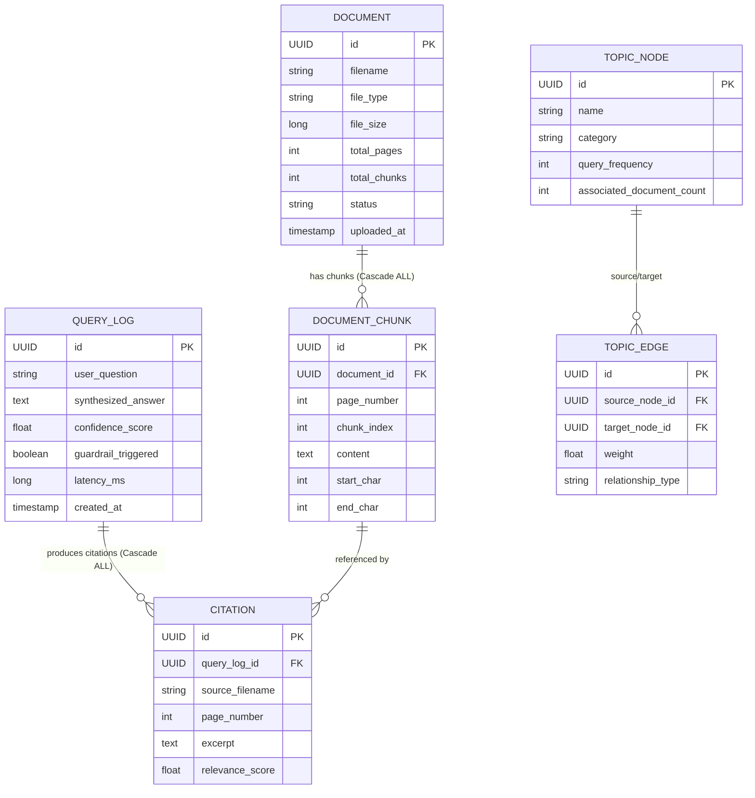

# OpsMind AI — Enterprise SOP Neural Brain & Knowledge Assistant

> **Context-Aware Corporate Knowledge Assistant**: Real-time SOP retrieval, verifiable precision citations, strict hallucination guardrails, and visual admin knowledge graph powered by **Spring Boot 3**, **Hibernate 6**, and **React 18**.

[](https://openjdk.org/)
[](https://spring.io/projects/spring-boot)
[](https://hibernate.org/orm/)
[](https://react.dev/)
[](https://tailwindcss.com/)
[](backend)

---

## 🌟 Key Features

1. **Precision Source Citations (100% Verifiable)**:
   - Tracks physical 1-based page numbers extracted via **Apache PDFBox 3.0.3**.
   - Identifies source document filename and extracts exact quote excerpts.
   - Provides confidence percentages and deduplicates multi-chunk hits per page.

2. **Strict Hallucination Guardrail (0.60 Confidence Threshold)**:
   - Any query falling below the **0.60** cosine similarity threshold is strictly intercepted.
   - Returns the standardized corporate compliance response:
     > *"I don't know based on the provided corporate SOPs."*
   - Automatically logs unanswered inquiries as **Knowledge Gaps** in Hibernate for administrative review.

3. **Pure Java Vector Space Model (VSM) & Cosine Similarity**:
   - Zero external LLM or API cost dependencies.
   - TF-IDF vectorization, tokenization, stop-word filtering, suffix stemming normalizer (`normalizeStem`), term overlap scoring, and phrase co-occurrence boost.

4. **Dynamic Topic Knowledge Graph**:
   - Canonical enterprise domain ontology across *Finance & Billing*, *Human Resources*, *Information Security*, and *Risk & Compliance*.
   - Automatically correlates indexed document chunks to calculate document coverage.
   - Real-time query traffic hook: inquiries dynamically increment topic node query frequencies and edge weights.

5. **Executive Analytics Dashboard**:
   - Real-time KPIs: Query Volume, Answered Grounded Inquiries, Guardrail Interception Rate (%), Average Latency (ms), Average Confidence.
   - Top-cited corporate SOP rankings.
   - Actionable Knowledge Gap tracker with automated department routing tags (*Finance & Billing*, *Human Resources*, *Information Technology*, *General Operations*).

6. **Interactive Multi-Tab Web Application**:
   - 💬 **Neural Chat & Citation Inspector**: Interactive chat with preset enterprise prompts and sliding citation drawer.
   - 🕸️ **Interactive Knowledge Graph Visualizer**: Force-directed SVG topology showing nodes, cluster colors, and live query traffic connection weights.
   - 📊 **Executive Analytics & Knowledge Gaps**: Real-time compliance monitoring and missing policy gap analysis.
   - 📁 **SOP Knowledge Base Manager**: Drag-and-drop PDF upload, chunk inspector, and sample SOP re-seeder.

---

## 🏗️ Architecture & Data Model



---

## 📁 Repository Structure

```
Opsmind-AI/
├── backend/                                         # Spring Boot 3 & Hibernate 6 Backend
│   ├── pom.xml                                      # Maven configuration
│   ├── src/main/java/com/opsmind/ai/
│   │   ├── OpsMindAiApplication.java
│   │   ├── controller/                              # REST API Endpoints
│   │   │   ├── DocumentController.java              # PDF upload, listing, chunks, deletion
│   │   │   ├── QueryController.java                 # RAG query, history, knowledge gaps
│   │   │   ├── KnowledgeGraphController.java        # Graph topology and sync
│   │   │   └── AnalyticsController.java             # Executive KPIs, top docs, gaps
│   │   ├── model/entity/                            # Hibernate 6 JPA Entities
│   │   │   ├── DocumentEntity.java
│   │   │   ├── DocumentChunkEntity.java
│   │   │   ├── QueryLogEntity.java
│   │   │   ├── CitationEntity.java
│   │   │   ├── TopicNodeEntity.java
│   │   │   └── TopicEdgeEntity.java
│   │   ├── repository/                              # Spring Data JPA Repositories
│   │   └── service/
│   │       ├── ingestion/                           # PDFBox parser & sliding chunker
│   │       ├── rag/                                 # VSM retrieval, citation engine, guardrail
│   │       ├── graph/                               # Knowledge graph topology engine
│   │       └── analytics/                           # Query analytics aggregator
│   └── src/main/resources/sample-sops/              # Bundled realistic enterprise PDFs
│       ├── Customer_Refund_and_Chargeback_SOP.pdf
│       ├── HR_Extended_Sick_Leave_Policy.pdf
│       └── IT_Remote_Access_and_VPN_Protocol.pdf
└── frontend/                                        # React 18 + TypeScript + Vite Frontend
    ├── index.html
    ├── package.json
    ├── vite.config.ts
    ├── tailwind.config.js
    └── src/
        ├── types/                                   # TypeScript domain interfaces
        ├── services/api.ts                          # Backend REST API client
        └── components/
            ├── Navbar.tsx                           # Global navigation header
            ├── chat/                                # Neural Chat & Citation Drawer
            ├── graph/                               # Force-directed Knowledge Graph
            ├── analytics/                           # Analytics & Knowledge Gap Tracker
            └── documents/                           # PDF Ingestion & Chunk Inspector
```

---

## 🚀 Getting Started

### Prerequisites
- **Java 17+** (JDK 21 or 24 supported)
- **Apache Maven 3.9+**
- **Node.js 18+** & **npm**

---

### 1. Run the Backend (Spring Boot & Hibernate)

```bash
cd backend
mvn spring-boot:run
```

The backend starts on `http://localhost:8080`.
- On startup, the application auto-detects if the knowledge base is empty and automatically ingests the 3 bundled corporate SOP PDFs with sliding-window chunking.
- H2 in-memory database console is available at `http://localhost:8080/h2-console` (JDBC URL: `jdbc:h2:mem:opsmind_db`).

To run the automated test suite (40 unit and integration tests):
```bash
mvn test
```

---

### 2. Run the Frontend (React + Vite + Tailwind)

In a separate terminal:

```bash
cd frontend
npm install
npm run dev
```

Open your browser at `http://localhost:5173`.

---

## 📡 REST API Reference

| Method | Endpoint | Description |
|---|---|---|
| `POST` | `/api/query` | Submit question; returns answer, confidence, guardrail status, and citations |
| `GET` | `/api/query/history` | Retrieve recent query audit logs |
| `GET` | `/api/query/knowledge-gaps` | List unanswered queries flagged by the guardrail |
| `GET` | `/api/graph` | Retrieve complete topic knowledge graph (nodes & edges) |
| `POST` | `/api/graph/sync` | Re-synchronize knowledge graph with indexed documents |
| `GET` | `/api/graph/top-topics` | Get top queried topics |
| `GET` | `/api/analytics/overview` | Executive dashboard overview metrics |
| `GET` | `/api/analytics/top-documents` | Most cited corporate SOP documents |
| `GET` | `/api/analytics/knowledge-gaps` | Unanswered questions with department suggestions |
| `GET` | `/api/analytics/topics` | Topic query distribution breakdown |
| `GET` | `/api/documents` | List all indexed SOP documents |
| `POST` | `/api/documents/upload` | Upload & index a new corporate PDF document |
| `GET` | `/api/documents/{id}` | Inspect document details and chunks |
| `DELETE` | `/api/documents/{id}` | Cascade-delete document and associated chunks |
| `POST` | `/api/documents/seed-samples` | Re-seed bundled enterprise SOPs |

---

## 📜 License

Licensed under the [MIT License](LICENSE).
